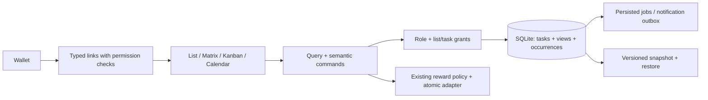

# Khảo sát TickTick và thiết kế năng suất cho Family-Organizer

Ngày: **11/10/2026**, timezone **Asia/Saigon**. Đây là tài liệu thiết kế, chưa phải kết quả triển khai.

## 1. Mục tiêu, phạm vi và bằng chứng

Người dùng muốn nâng cấp Family-Organizer bằng TickTick, ưu tiên **Eisenhower Matrix** và **Kanban**, hợp nhất Wallet. Giữ React19/TypeScript5.8/Vite6/Tailwind4/Express4/SQLite/auth/PWA/một gia đình; Node/addon pin qua F01. Target mới là Windows-native trên VPS2019, code Codex Cloud, kiểm thử Windows Actions theo [master](../plans/2026-10-11-family-organizer-upgrade-master.md). Không triển khai REST API công khai, scoped integration tokens, MCP hoặc bank sync; giữ API đăng nhập nội bộ, tỷ giá/giá thị trường và nhập file.

- **UI:** trực tiếp quan sát giao diện đang đăng nhập; không đồng nghĩa đã kiểm thử lưu hoặc mọi điều kiện lỗi.
- **DOC:** hướng dẫn chính thức; phần desktop/mobile không tự động được coi là có trên web.
- **REPO:** repo đích duy nhất là [DongVienNguyen/Family-Organizer](https://github.com/DongVienNguyen/Family-Organizer/tree/b2c26516c6d6c6cc3edf3e83391eb84cfaa2cd91), public, branch `main`; HEAD đã xác minh là `b2c26516c6d6c6cc3edf3e83391eb84cfaa2cd91`, trùng baseline source khảo sát. Mọi triển khai/PR/CI dùng repo đích này.
- **NEW:** quyết định thiết kế của ứng dụng mới, không phải khẳng định thuật toán của TickTick.
- **GAP:** chưa xác minh; có checklist khảo sát bổ sung.

Đã đọc Matrix, menu từng ô, form sửa ô và thông báo Premium; Tasks/Inbox/list/empty state; Kanban và menu cột/group/sort; task detail, lịch hạn, nhắc, lặp tùy chỉnh và menu thao tác; Settings/Features/Smart List/Notifications/Date & Time/More/Collaborate/Integrations & Import/Shortcuts/AI/Appearance. Đối chiếu tài liệu Matrix, Kanban, task details, recurrence, calendar, focus, habits và feature overview. Browser bị gián đoạn khi tiếp tục nên dùng Computer Use để đọc các tab còn mở.

Tài khoản tham chiếu là **bản miễn phí**. Calendar, Habit, Pomodoro, Countdown và AI đang tắt trong Features; không bật chúng hoặc nâng cấp gói để khảo sát. Thao tác sửa quy tắc Matrix bị chặn bởi Premium. Không tạo/sửa/hoàn thành/xóa task, không gửi comment/mời thành viên, không tải dữ liệu riêng, không kết nối dịch vụ hoặc tạo token. Có chuyển chế độ xem và mở rồi hủy form. Không chép nội dung công việc, email, khóa hoặc dữ liệu riêng vào tài liệu.

Mục tiêu là xây hành vi tương đương trong phạm vi đã chọn. Không thể suy ra source, backend, toàn bộ edge cases hoặc xác nhận “clone 100%” từ giao diện này.

## 2. Bản đồ chức năng tham chiếu

| Nhóm | Tính năng và logic đã xác định | Bằng chứng / áp dụng |
|---|---|---|
| Điều hướng | Tasks, Matrix, tìm kiếm; sidebar All/Today/Next 7 Days/Inbox, Lists, Filters, Tags, Subscribed Calendars, Completed, Won't Do, Trash | UI; các mục có thể ẩn/hiện theo Smart List |
| Tạo task | Input nhanh, tạo từ list/section; default date/reminder/priority/tag/list/vị trí đầu/cuối; nhận dạng date/tag/URL có setting | UI settings; parser và hành vi lưu chưa kiểm thử |
| Task detail | Ngày/giờ/timezone, duration, repeat/reminder, priority, mô tả; menu subtask, pin, tag, attachment, activities, template, duplicate, link, note conversion, mindmap, export/print/delete | UI; menu hiện diện không chứng minh thao tác thực thi |
| Nội dung | Checklist, subtask, Markdown/style, progress, comment, attachment | UI + DOC; phân biệt checklist với task con có ID |
| Tổ chức | Folder → List → Section → Task → Subtask; list/tag/filter/smart list cùng nhìn vào task | DOC; NEW bổ sung quyền gia đình và task link |
| List/Kanban/Timeline | Chế độ xem của tập task, không phải ba bản sao dữ liệu | UI + DOC; Timeline chưa mở app trực tiếp |
| Matrix | Bốn ô, rule theo list/tag/date/priority, group/sort/order và Show Completed | UI + DOC; ưu tiên triển khai |
| Lịch | Week/month/year/agenda và view options; tác vụ có start/end và future recurrence previews; subscriptions | DOC; module app đang tắt |
| Cộng tác | Share list, assign, comment/activity; default thông báo task add/move/delete/complete/undo | UI settings + DOC feature overview; không thử invite |
| Nhắc/lặp | On time; daily/weekly/monthly/yearly/weekdays/custom; due/completion/specific-date bases, end conditions | UI + DOC; scheduler nội bộ chưa biết |
| Focus | Pomodoro hoặc stopwatch gắn task, pause/adjust/log và thống kê | DOC; app đang tắt |
| Habit/Countdown | Goal/frequency/check-in/statistics; ngày quan trọng và recurrence | DOC + feature/menu UI; app đang tắt |
| Notes/Summary | Convert task to note, template; Summary sidebar; hệ sinh thái notes | UI menu; conversion/export format chi tiết GAP |
| Tùy biến | Sáng/tối/theme/interface style; date/time/week start/timezone; ngôn ngữ, shortcuts, feature visibility | UI; giữ design system repo |
| Nhập/tích hợp | Import Todoist/Microsoft Todo/Things/OmniFocus/Toodledo/iCal; calendar và Notion/Zapier/IFTTT/email/chat integrations được liệt kê | UI menu; chỉ đề xuất file import/ICS trong backlog có điều kiện, không giả lập kết nối |
| AI/native | UI có AI/MCP/CLI và nhiều feature tùy nền tảng | UI + DOC; MCP/API công khai excluded; AI chỉ draft tùy chọn; OS widgets/sticky-note native không coi là web |
| Account | Backup/import backups/account security/API Keys/Premium/account deletion | UI menu; dùng quản trị hiện có, không sao chép billing/API Keys của TickTick |

Nguồn nền: [Features](https://ticktick.com/features), [Task Details](https://help.ticktick.com/articles/7055782408586526720), [FAQ](https://help.ticktick.com/articles/7055792921664028672), [What's New](https://help.ticktick.com/articles/7082552170989486080). Các tính năng native hoặc mobile như voice capture không được hứa tương đương trên web.

## 3. Eisenhower Matrix — khảo sát sâu

### 3.1. UI đã đọc

Bố cục 2×2: Urgent & Important, Not Urgent & Important, Urgent & Unimportant, Not Urgent & Unimportant. Màu đỏ/vàng/xanh lam/xanh lục và biểu tượng riêng; ô có empty state. Card có tiêu đề, list/tag, giờ/ngày, dấu lặp/nhắc. Nhóm thời gian có thể gập; tên ô không tự chứng minh phép tính urgency.

Nút “…” toàn Matrix có Show Completed. Menu mỗi ô có Edit, Group by Time, Sort by Time, Order Oldest First. Form Edit có tên ô, Lists, Tags, Date và High/Medium/Low/None/All priorities; Restore Examples, Close, Save. Ô thứ nhất đang chọn High; Date hiển thị All. Nhấn mở Date cho thấy thông báo nâng cấp Premium; không đổi hoặc lưu rule. Không suy ra các ô khác có cùng điều kiện hoặc một bộ “deadline + importance” đang bật.

### 3.2. DOC và giới hạn

TickTick mô tả hai cách cấu hình: bốn mức priority tương ứng bốn ô; hoặc phối hợp priority với thời gian. Khi kéo task giữa ô, các thuộc tính liên quan có thể thay đổi. Tạo trực tiếp trong ô cũng có thể gán thuộc tính từ rule. Bộ lọc ô có list/tag, time window và priority. Một view theo thời gian có thể phân loại lại khi ngày thay đổi. Chưa xác minh giải quyết rule chồng nhau, task không khớp hoặc phép đảo rule tùy chỉnh. [Cách dùng](https://help.ticktick.com/articles/7055782055577124864), [quy tắc](https://help.ticktick.com/articles/7055782040439881728).

### 3.3. NEW: hai preset và rule engine minh bạch

**Preset deadline + importance** là mặc định mới: `high|medium` là important, `low|none` là unimportant. Urgent nếu chưa kết thúc và dueDate trước đầu ngày `today + horizonDays + 1`, mặc định `horizonDays=1` (quá hạn/hôm nay/ngày mai). Task không có hạn là nonurgent. Deadline dạng giờ xét theo timezone của view; ngày all-day hết hạn tại đầu ngày kế tiếp, không dùng UTC midnight cho ngày địa phương.

| Important | Urgent | Ô | Hành động gợi ý |
|---|---|---|---|
| Có | Có | Q1 | Làm trước, kiểm tra hạn |
| Có | Không | Q2 | Xếp lịch, giữ thời gian tập trung |
| Không | Có | Q3 | Phân công, kiểm tra người nhận |
| Không | Không | Q4 | Backlog hoặc Won't Do có chủ ý |

**Preset priority-only** do ứng dụng mới định nghĩa rõ: high→Q1, medium→Q2, low→Q3, none→Q4. Không gọi đây là thuật toán urgency theo hạn. Cho đổi preset có preview số task đổi ô; không sửa task hàng loạt chỉ vì đổi view.

Custom Matrix có bốn rule AST typed, tối đa 32 điều kiện/view, depth≤4: list, section, tag(any/all), assignee, priority, lifecycle, due window. OR trong một chiều/AND giữa các chiều; NOT chỉ trên điều kiện typed. Không lưu hoặc chạy JavaScript expression từ người dùng. Rule-relative-date resolve một lần với `now`+timezone cho cả request. Phân loại sau ACL; completed/wont_do/trash bị loại theo mặc định, có switch hiển thị riêng.

Custom rules chồng nhau: **first match theo thứ tự ô** là policy của ứng dụng mới; editor báo tất cả matches và cho preview. Task không khớp vào khay “Chưa phân loại”, không biến mất. Tổng header là unique task IDs; không cộng số bản chiếu trùng. View/cấu hình riêng từng user; view chia sẻ có quyền quản lý riêng.

### 3.4. NEW: kéo thả không sửa hạn âm thầm

`previewMatrixMove` trả patch, target, before/after, warnings, taskRevision và viewRevision. UI hiển thị trường sẽ đổi trước khi apply. Priority-only đổi priority; preset deadline có đề xuất priority/date nhưng thay hạn thật phải được người dùng chọn rõ. Nếu không muốn đổi hạn, chọn ghim ô cho riêng view; badge “Ghim” và nút bỏ ghim luôn hiện. Override gắn view ID/config revision, không tác động priority/deadline, có expiry tùy chọn; stale override sau đổi config phải được xem xét lại.

Rule tùy chỉnh không đảo được hoặc có nhiều cách đảo: yêu cầu chọn thuộc tính trong preview; nếu chưa có patch hợp lệ thì không cho apply. Server kiểm quyền sửa từng field và tính lại target bằng rule hiện tại. Nếu patch không đưa task vào ô mong muốn, trả 422 cùng lý do. Xung đột revision→409, rollback optimistic UI và giữ lựa chọn nháp. Kéo ô chỉ đổi thứ tự view, không đổi toàn bộ task.

## 4. Kanban — khảo sát sâu

### 4.1. UI và DOC

List menu có ba biểu tượng List/Kanban/Timeline, Show Completed, Show Details, View Options, Add Section, Share, List Activities, Print. Kanban của list trống có cột Not Sectioned, count, New Task, More và New section. Menu Not Sectioned: Rename, Add Section to Left/Right, Move to; không thấy Delete trong menu cột mặc định này.

Group by: Custom, Date, Created Time, Tag, Priority. Sort by: Custom, Date, Created Time, Modified Time, Title, Tag, Priority. Chưa thử đổi group, di chuyển/xóa section hoặc thả task thật. DOC có group theo assignee trong cộng tác; không suy ra tùy chọn này phải hiện ở list cá nhân.

DOC mô tả Kanban là view của list, smart list, folder hoặc tag; sections/cards có thể kéo và thêm task vào section. Cột có thể mô tả chủ đề hoặc tiến trình. Đưa card vào section đặt tên Done không đủ bằng chứng checkbox được hoàn thành. [Kanban](https://help.ticktick.com/articles/7055782353376903168), [Timeline](https://help.ticktick.com/articles/7055782331050622976).

### 4.2. NEW: tách cột phân loại và workflow

- **Section board:** sectionId là tổ chức trong list. Đổi cột chỉ đổi section/rank; không tự hoàn thành task.
- **Workflow board:** Todo/Doing/Waiting/Review/Done là projection của lifecycle, blocked flag và approval. Pending review không phải completed. Won't Do/trash ở khay riêng; overdue là badge/smart lane chỉ đọc.
- **Group board:** priority/date/assignee/tag. Kéo chỉ sửa dimension đang nhóm nếu được phép. Created/modified time hoặc derived overdue không cho kéo sang nhóm để sửa metadata hệ thống.
- Tag có thể tạo nhiều card projection cho một task; show badge trùng, tổng unique IDs và bulk chỉ xử lý một lần. Kéo từ tag A sang B chỉ thay A bằng B sau preview, giữ các tag khác; kéo từ All-tags cần người dùng chọn replace/add.

Cột workflow Done gọi command hoàn thành, không PATCH status tùy ý. Trẻ cần duyệt sẽ vào Review và chưa có điểm; người lớn chuyển pending task sang Done gọi approve. Rời Review bằng trả lại phải có reason; Review không là cột drop để tự gán pending. Waiting dùng blocked=true/reason; rời Waiting bỏ blocked nếu command hợp lệ. Lifecycle nền vẫn `todo|in_progress|completed|wont_do`, approval và blocked độc lập.

Columns có WIP optional: `soft` cảnh báo; `hard` chặn vượt hạn mức trong cùng transaction, admin override có reason/audit. WIP đếm root tasks active theo ID, bao gồm blocked tasks, bỏ completed/wont_do/trash; Review có limit riêng nếu muốn. Due/tag grouping không mặc định áp WIP. Filter cá nhân không được làm WIP server đếm thiếu task khác trong board; con số hiển thị cho user thiếu quyền phải tránh lộ private count.

Thứ tự dùng integer rank có khoảng cách 1024; board revision chống concurrent moves; rebalance trong transaction khi hết khoảng trống. Manual order chỉ dùng khi sort=custom; không làm giả dueDate để xếp card. List scope changes/move section phải cập nhật rank/membership và quyền nguyên tử. Section delete mặc định archive và chuyển task sang Not Sectioned sau preview; không cascade xóa task.

UX: pointer/touch/keyboard DnD, nút “Di chuyển…” tương đương cho bàn phím; drag overlay, auto-scroll, collapse columns, quick-add, counts, task drawer, loading/error/empty, optimistic rollback409. Không để thao tác menu vô tình check completion.

## 5. Những phần còn lại và cách nâng cấp

| Khả năng | Thiết kế NEW cho Family-Organizer | Ưu tiên |
|---|---|---|
| Task core | Inbox/list/section/tag, priority none, due nullable, pin, blocked reason, lifecycle, progress, notes/attachments, comments/activity | P0 nền Matrix/Kanban |
| Checklist/subtask | Checklist là items trong task; subtask có task ID/ACL/lịch riêng, không cycle, depth≤5; root-only views mặc định | P0 |
| Smart views | Today/Next7/Assigned/Overdue/Completed/Won'tDo/Trash; saved filter, fulltext accent-insensitive, unique selection | P0 |
| Recurrence | Due/completion/specific dates, interval/end/count/exceptions, skip/one/future/series edits; luân phiên người nhận hiện có | P0–P1 |
| Calendar/Timeline | Chung task data + FamilyPlan, all-day/timed, month/week/agenda; duration và reschedule preview; future cycles ảo | P1 |
| Reminders | Outbox persisted, retry/dedupe, quiet hours, overdue digest, notification inbox; dùng web-push hiện có | P1 |
| Notes/templates/import | Nối Notes hiện có; checklist/template clone IDs mới, linked conversion có preview; JSON/CSV export/import stage/undo | P1 |
| Focus | Pomodoro25/5 và long-break15 sau4, stopwatch, one-active/user, sessions linked task/habit; không tự complete task | P2 |
| Habit | Daily/specific weekdays/n-times per week, boolean hoặc numeric goal, log unique date, skips/archive/streak/heatmap | P2 |
| Countdown | Birthday/anniversary/deadline, local-date inclusive toggle, linked reminders; không tự thành recurring task | P2 |
| Review/analytics | Q2 time share, overdue age, WIP/blocked aging, throughput/cycle time, workload; không dùng làm chấm điểm người tự động | P2 |
| NLP/AI | Parser tiếng Việt có preview; AI đề xuất/summarize draft dùng Assistant hiện có nếu bật; mọi ghi cần người dùng xác nhận | Optional |
| Offline | Read cache per user; writes opt-in sau replay/conflict tests, không offline approve rewards hoặc shared WIP-hard transitions | Optional |
| External/native | Calendar file ICS trước; OAuth calendars/Notion/chat/email-to-task/OS widgets/CLI/native overlays là backlog riêng | Deferred/excluded như ghi rõ ở plan |

Nguồn đối chiếu: [recurrence](https://help.ticktick.com/articles/7055782206349770752), [Calendar](https://help.ticktick.com/articles/7055782166172532736), [Calendar options](https://help.ticktick.com/articles/7055782085826445312), [Start Focus](https://help.ticktick.com/articles/7055782010496745472), [Start Habit](https://help.ticktick.com/articles/7055781878401335296). DOC xác nhận recurrence có ba cơ sở tính; focus có Pomo/stopwatch gắn task; habit có frequency và goal. Các con số/policy mới trong bảng là quyết định ứng dụng mới.

## 6. Repo hiện có và rủi ro tích hợp — REPO

`src/types.ts`: TaskStatus todo/in_progress/completed/**overdue**; priority low/medium/high; `dueDate` string `YYYY-MM-DD HH:mm`; creator/assignee/isShared/tags/comments/history. Có rewardPoints, completedBy/At, pendingApproval/submittedBy/At/proof/rejection, recurrence interval/end và rotationMemberIds/sourceRecurringTaskId. `FamilyPlan` có start/end/recurrence/creator/shared/color; `Note` có Markdown/tags/shared/allowedRolesToEdit.

`src/components/Tasks.tsx` đã có **Kanban bốn cột cố định** Todo/Doing/Overdue/Completed, filter text/status/assignee/priority/scope, completed window, detail/create/submit/reject modals. Cột dựa trên effectiveStatus; không tìm thấy `draggable`, onDrag/onDrop hoặc DndContext. Không có Matrix. Giữ các luồng đang dùng khi nâng cấp.

`server.ts` GET `/api/tasks` hiện trả `FamilyDB.getTasks()` cho phiên đăng nhập; giới hạn một phần đang ở frontend. POST có write guard cho child/guest theo creator/assignee và conflict nếu có baseUpdatedAt; không coi đó là ACL đầy đủ. NEW phải lọc tại server cả direct endpoints, events, counts, search, export, attachment, notification; whitelisted field commands chống forged comments/creator/reward fields.

`FamilyDB.saveTask` xử lý completion/reward/approval/recurrence; approve/reject routes là admin/member. Cổng duyệt xét **actor CHILD + recipient CHILD + reward>0 + reward>threshold**. Người nhận là assignee hoặc actor, không bịa policy mới chỉ theo assignee. Chưa kết luận toàn bộ semantics reopen/rotation/reward reversal khi chưa đọc và test đầy đủ; P10 yêu cầu characterization tests trước cutover.

Module cần nối: `Tasks.tsx`, `Schedules.tsx`, `Notes.tsx`, `Dashboard.tsx`, `GlobalSearch.tsx`, `Assistant.tsx`, `Settings.tsx`, `PushNotificationsCard.tsx`, `src/utils/recurrence.ts`, `server/icsFeed.test.ts`, `server/db.ts`, `server/sqlite.ts`, App/server wiring. Không có checkout source trong `wallet-app`; repo source đã đọc từ GitHub. Không khởi tạo CodeGraph.

## 7. Kiến trúc và dữ liệu NEW

Phương án 1 giữ JSON collection cho mọi capability: ít migration nhưng move/WIP/reward/recurrence khó đảm bảo nguyên tử và query/index. Phương án 2 thêm bảng task/list/view trong **cùng SQLite**, adapter giữ API cũ: phù hợp stack, chịu được concurrent actions; cần cutover/backup rõ. Phương án 3 tách service/cloud storage: tăng vận hành và lệch repo. **Chọn phương án 2**, phối hợp migrations với Wallet qua plan tổng hợp.

| Bảng prefix `productivity_` | Nội dung |
|---|---|
| lists/folders/list_grants/sections | visibility, quản lý, sort, archive; section thuộc đúng list |
| tasks/task_tags/check_items/task_links | lifecycle, due/start, priority, assignee, blocked, progress, parent, legacy ID, revision, safe attachment refs |
| comments/activities/attachments | actor/audit và media có ACL; không embed secret vào event |
| views/matrix_rules/matrix_overrides/positions | config schemaVersion/revision, owner, filter/group/sort, pins và rank |
| recurring_series/occurrences | anchor/base/rule/timezone/exception/ordinal; unique(seriesId,occurrenceKey) |
| commands/reward_event_claims/outbox | idempotency payload/result, unique completion/reversal claims, durable fanout jobs |
| focus_sessions/focus_segments | timer state/version, timing and manual edits; unique active per user |
| habits/habit_logs/countdowns | goals/frequency/timezone, logs/check-in/archive |
| import_batches/import_rows | preview/mapping/errors/commit IDs/undo state |

Lifecycle terminal fields consistent: completedAt only for completed; pendingApproval incompatible completed; wont_do không cộng điểm. Overdue là predicate của clock và due, không lifecycle. Legacy status overdue không biết trạng thái trước thì map todo + migration note; chỉ phục hồi in_progress khi lịch sử chứng minh, không suy đoán.

Due date có tagged union `none|all_day(date,timezone)|timed(instantUtc,timezone)`; scheduledStart/end độc lập **deadline**. Khi timebox task Q2, không tự đổi deadline. Legacy parse theo timezone deployment Asia/Saigon, lưu raw và đánh dấu assumption; không dùng Date.parse phụ thuộc host. Khoảng filter `[from,toExclusive)`. Ngày31 policy clamp hoặc skip được lưu explicit; recurrence completion anchor là thời điểm hoàn thành được chấp nhận, không lúc trẻ submit nếu cần approval.

Permission NEW: admin quản trị theo repo; member quản lý list được grant; private task chỉ creator/assignee/grant hợp lệ. Child/guest read shared hoặc own/assigned như UI hiện có; chỉ sửa task own/assigned theo whitelist và không cấp quyền/mức điểm/reward ledger/approve. Shared visibility không mặc nhiên cho limited roles sửa. Task con không được mở rộng visibility vượt parent; list move phải kiểm cả source và destination. Notifications và SSE phải lọc người nhận, không broadcast toàn task nhạy cảm.

## 8. Recurrence, reward và transaction

Một semantic command ghi task, approval state, activity, recurrence instance, reward event claim và outbox trong **một write transaction**. JSON collection reward hiện có được cập nhật qua adapter cùng SQLite handle; không gọi hàm save toàn DB ngoài transaction hoặc duy trì ledger canonical thứ hai. I1 trong master sở hữu adapter chung; các writer điểm thưởng khác cũng phải dùng gateway đó.

Pending child completion: chưa tăng points, chưa materialize next accepted occurrence. Approval retry: unique(task occurrence,completion event) chỉ cộng một lần, tạo successor một lần. Reopen đảo reward đúng bằng compensating entry liên kết grant gốc, không xóa history; admin review policy trước release. Reject quay về trạng thái làm việc, giữ lý do, không trừ khoản chưa từng cấp.

Due-date series có anchor cố định; completion-date series anchor acceptedCompletedAt; specific dates dùng danh sách được sort/unique. Preview future instances là virtual, không task persisted/reward. Skip không points, không tăng vòng luân phiên người nhận; accepted completion tăng rotation một lần. Edit this/future/all giữ completed history, không thay ngầm task đã được duyệt. Exceptions được persist. Policy missed cycles phải explicit trong editor; mặc định hiển thị occurrence quá hạn hiện hành, không tự thưởng hay complete các kỳ đã lỡ.

## 9. Migration, vận hành và nghiệm thu

Feature flag `productivityV2`: disabled/pilot/enabled. Migration giữ task IDs/comments/history/recurrence source links/points references; tạo legacy default list, map tags, preserve proof và ACL. No dual-write. Adapter `/api/tasks` đọc cùng canonical store và chuyển mutations sang commands; compatibility response giữ trường cũ. New optional fields không bị old forms xóa.

Snapshot có manifest chung Wallet+productivity+legacy+media, version/checksum và validate trước swap. Online backup giữ WAL; restore không replay notification/points. Rollback bảo toàn new fields/events, có writes mới phải reconcile trước restore snapshot cũ. Windows service/DATA_DIR/file-lock/recovery theo F07, không Docker/Pi compatibility.

Nghiệm thu: task ID đồng nhất bốn view; matrix midnight/timezone/no-date/all-day đúng; drag preview/cancel; section Done không complete, child workflow Done vào Review; WIP/reward/recurrence concurrency; direct API/SSE/export/media privacy; restore pins/rank/occurrences/points. Synthetic10kactive+100khistorical page50 p95<500ms Windows CI reference, Matrix<1s, move commit p95<500ms; đo VPS2019 riêng R02. Đây là targets chưa benchmark.

## 10. GAP và phạm vi chưa cam kết

| ID | Chưa kiểm chứng | Cách kiểm tra / quyết định |
|---|---|---|
| T01 | Rule/date/filter Matrix Premium, overlaps/unmatched, persisted reorder | Tài khoản thử có entitlement; fixture synthetic, không dùng account cá nhân làm sandbox |
| T02 | Matrix move/add inverse patch và undo | Fixture priority/due/tag; so before/after và timezone |
| T03 | Kanban section CRUD, board move, multi-tag groups | Board thử có task giả; kiểm checkbox độc lập section |
| T04 | Kanban assignee/shared list, concurrent rank/WIP | Shared sandbox; WIP là NEW, không gán cho TickTick |
| T05 | Repeat exceptions/series edits/missed dates/end/reopen | Fixture clock/DST/leapday và reward characterization repo |
| T06 | Calendar/Timeline actual web views/duration drag | Module tham chiếu đang tắt; DOC trước, UI thử sau |
| T07 | Focus/habits/countdowns web logging/sync/stat formulas | Module đang tắt; thiết kế NEW và tests độc lập |
| T08 | Note conversion, export formats, templates, Trash recovery retention | Tài khoản dữ liệu disposable; không thử delete thật |
| T09 | Share roles/invites/comments/notification policies | Sandbox được cho phép; không gửi invite/comment từ phiên khảo sát |
| T10 | Import provider/OAuth/Notion/chat/email/native/mobile-specific | Deferred; file import nội bộ trước; public API/MCP excluded |
| T11 | Premium limits/themes/AI/mindmap/platform parity | Không sao chép entitlement/billing; AI/mindmap draft là optional |
| T12 | Family-Organizer reward/rotation/reopen và read ACL toàn bộ | Tests trên checkout đúng HEAD trước migration; source tại commit đã nêu |

Tham chiếu UX không thay thế acceptance criteria của ứng dụng mới. Plan chi tiết: [Productivity](../plans/2026-10-11-productivity-family-organizer.md). Plan cuối cùng điều phối cả tài chính và năng suất: [Family-Organizer tổng hợp](../plans/2026-10-11-family-organizer-upgrade-master.md).
